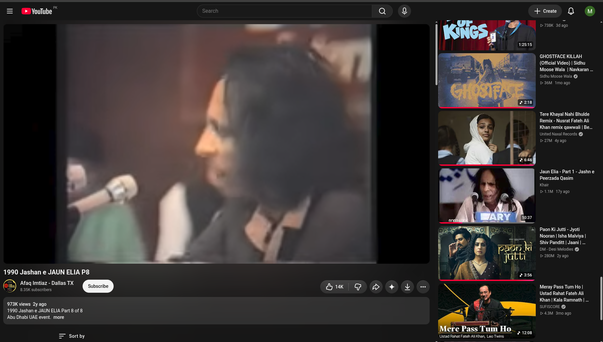
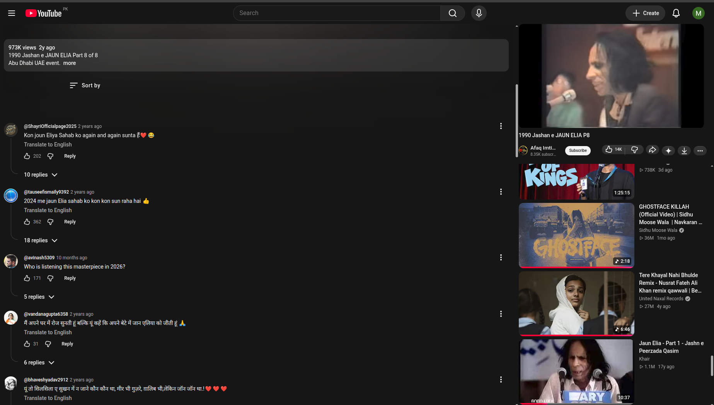

<p align="center"></p>

# YouTube Split Scroll: Comments Left & Docked Player

## The problem it solves

YouTube's watch page makes you choose between the video and the conversation:

- **Comments end up in the wrong place.** They get pushed over to the right
  side of the page, mixed in with the suggested videos, instead of sitting
  under the video where you expect them.
- **Everything scrolls as one page.** Reading comments scrolls the player,
  title and Like/Subscribe buttons out of sight, and scrolling the suggested
  videos drags the rest of the page along with it.

This extension puts the comments back under the video, gives each side its own
scrollbar, and keeps the player, title and actions on screen (docked in the
right column) while you read comments.

## What it does (on YouTube watch pages)

- Moves the comments back to the left column, under the video.
- The left column (video, details, comments) and the right column (suggested
  videos / playlist / live chat) scroll independently; the page itself doesn't
  scroll.
- Once the video player has scrolled out of view on the left (90% by default),
  the player, video title and channel/subscribe/like row dock to the top of the
  right column at its width. Suggested videos scroll beneath them. Scrolling
  back up returns them to the left column. While a live chat is open the player
  stays on the left, so the chat isn't covered.
- A **Comments** / **Back to video** button at the bottom of the left column
  jumps between the two.
- Drag the line between the columns to **resize** them (or focus it and use the
  arrow keys; double-click resets). The width is remembered.
- Only the standard two-column view is changed by default. Fullscreen and the
  narrow single-column layout keep YouTube's default behaviour; theater mode
  does too unless you turn on split scrolling for it.

## Settings (toolbar popup)

Click the toolbar icon to:

- Turn the extension **on or off** with the switch at the top. Changes apply
  to open YouTube tabs immediately, with no reload. While it's off, the toolbar
  icon turns grey with an **OFF** badge.
- Turn **docking** on or off, choose how far the player scrolls away before it
  docks (50–100%), and dock the **player only** or the player with its title
  and actions.
- Show or hide the **Comments / Back to video** button.
- Put the **suggestions on the left** (video and comments on the right).
- **Hide Shorts** in the suggestions.
- Use **split scrolling in theater mode**: the page scrolls the wide player
  away, then each column scrolls on its own.
- Reset the suggestions column width.

**Keyboard shortcut:** <kbd>Alt</kbd>+<kbd>Shift</kbd>+<kbd>Y</kbd> turns the
extension on or off. Change it at `chrome://extensions/shortcuts` (Chromium
browsers) or in Firefox's add-on settings → *Manage Extension Shortcuts*.

## Screenshots

| Player at the top, right column scrolls independently | Scrolled down to the comments (player docked right) |
| --- | --- |
|  |  |

## Supported browsers

- Chromium-based desktop browsers: Google Chrome, Microsoft Edge, Brave,
  Opera, Vivaldi (any version with Manifest V3 support, Chrome 88+).
- Firefox 121+ (Manifest V3); loaded as a temporary add-on, see below, or
  permanently once signed on addons.mozilla.org.
- Not supported as-is: Safari (needs conversion with Xcode's Safari Web
  Extension tools) and mobile browsers.

## Installation: Chrome, Edge, Brave, Opera, Vivaldi

1. Extract this ZIP archive into a permanent folder on your computer.
2. Open the extensions page:
   - Chrome, Brave, Vivaldi: `chrome://extensions/`
   - Edge: `edge://extensions/`
   - Opera: `opera://extensions/`
3. Turn on **Developer mode** (toggle in the top-right or left sidebar).
4. Click **Load unpacked** and select the folder containing `manifest.json`.
5. Open or refresh any YouTube video page.

## Installation: Firefox

1. Open `about:debugging#/runtime/this-firefox`
2. Click **Load Temporary Add-on...** and select `manifest.json`.
3. Open or refresh any YouTube video page.

Temporary add-ons are removed when Firefox restarts; a permanent install
requires the extension to be signed through addons.mozilla.org.

## Updating after code changes

Click the reload icon on the extension's card (Firefox: **Reload** in
`about:debugging`), then **refresh the YouTube tab**.

Browsers don't put the new version into YouTube tabs that were already open,
so until a tab is refreshed it keeps the old behaviour and ignores the switch
and settings. Opening the popup on such a tab shows a notice with a
**Reload tab** button.

## Development

Requires Node.js 18+.

```sh
npm install              # web-ext and Playwright
npm run lint             # web-ext lint (Firefox validator)
npm run build            # store-ready ZIP in dist/
npm run test:install     # once: download Playwright's Chromium
npm test                 # smoke tests against live YouTube (HEADED=1 to watch)
npm run icons            # re-render icons/*.png and the store promo tile from the SVGs
```

The smoke tests load the unpacked extension into Chromium and check the layout,
docking, settings, the on/off badge and the popup on a real video. YouTube
changes its markup without notice, so a failing smoke test usually means a
selector in `content.js` or `styles.css` needs updating.

### Releasing

1. Bump `version` in `manifest.json` and `package.json`, and add an entry to
   `CHANGELOG.md`.
2. Commit, then tag and push: `git tag v1.2.0 && git push --tags`.
3. The **Release** workflow lints, builds and publishes the ZIP as a GitHub
   release. Upload that ZIP to the stores; listing copy is in
   [`store/listing.md`](store/listing.md).

GitHub Actions: **CI** (lint + build on every push/PR), **Release** (on `v*`
tags) and **Smoke test** (live YouTube, weekly and on demand).

### Translations

All user-facing text lives in `_locales/<lang>/messages.json`. To add a
language, copy `_locales/en/` to `_locales/<code>/` (e.g. `ur`, `de`) and
translate the `message` values; the browser picks the user's language
automatically.

## Files

| File            | Purpose                                                  |
| --------------- | -------------------------------------------------------- |
| `manifest.json` | Extension definition (Manifest V3, YouTube content script). |
| `settings.js`   | Setting defaults, shared by the content script and popup. |
| `content.js`    | Moves comments, docks/undocks the player, divider, jump button, theater split. |
| `styles.css`    | Independent-scroll layout, docked stack, divider, Shorts hiding. |
| `background.js` | OFF badge and the toggle keyboard shortcut.               |
| `popup.html`, `popup.css`, `popup.js` | Toolbar popup: on/off switch, settings, developer details, links. |
| `_locales/`     | Translatable text (English included).                     |
| `icons/`        | Extension icons: PNGs rendered from `icon.svg` (48/128px) and `icon-small.svg` (16/32px, plus grey "off" variants) by `npm run icons`. |
| `tests/`, `playwright.config.js` | Playwright smoke tests.                  |
| `web-ext-config.mjs`, `scripts/` | Lint/build config and version check.     |
| `.github/workflows/` | CI, release and smoke-test workflows.                |
| `store/listing.md` | Store listing copy and permission justifications.     |
| `CHANGELOG.md`, `PRIVACY.md`, `TERMS.md` | Release notes, privacy policy, terms of use. |

## Developer

**Majid Ali** is a Full Stack Web Developer based in Islamabad, Pakistan,
working with Vue.js, Nuxt.js, React and TypeScript on the frontend and
Python/FastAPI microservices (gRPC, Kafka, MSSQL, Redis, Docker) on the backend.

- Portfolio: [majidev.netlify.app](https://majidev.netlify.app)
- GitHub: [Majid-Ali-Watto](https://github.com/Majid-Ali-Watto)
- LinkedIn: [majid-ali-074b97245](https://www.linkedin.com/in/majid-ali-074b97245/)

Found a bug or have an idea? [Open an issue](https://github.com/Majid-Ali-Watto/youtube-split-scroll/issues).

## License

MIT, see [LICENSE](LICENSE).

- [Changelog](CHANGELOG.md)
- [Privacy Policy](PRIVACY.md)
- [Terms of Use](TERMS.md)
